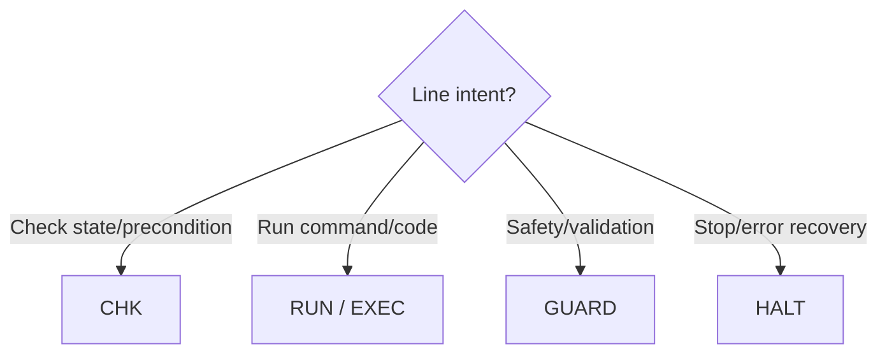

# SKILL:OPTIMIZE_LLM_SKILL

> Purpose: compress a verbose Markdown skill into terse, token-optimized form with zero logic loss.

[CONTEXT: Context window constraints require stripping grammar filler, structural bloat, and padding while preserving 100% logic.]

## Workflow

The caller's skill-wide invariants and these invariants govern every phase of the pipeline:

- INVARIANT[draft-01]: This workflow does not write files, and all transformations apply only to an in-memory draft.
- INVARIANT[body-scope-01]: Alter the draft body only where the strip, convert, and tag phases apply.

These are agent instructions, not a runnable Makefile. Never submit this workflow to a shell. Follow `emit`; complete each prerequisite successfully before its dependent recipe. Skip each recipe's first line, the safety sentinel. No subsequent line is a shell command. Follow recipe actions in order, including conditional stops.

Before each phase, read its invariants and the applicable skill-wide invariants. Check preconditions before relevant actions, maintain constraints during them, and verify postconditions afterward. All actions remain subject to applicable permissions and confirmations.

Follow the caller's format invariant unless the user explicitly requests a different output format. Honor other specific output requirements over default formatting and output rules.

For agent-lang, place functional anchor tags in natural-language actions or nearby prose without changing required agent-lang syntax. Only `@` lines after the skipped sentinel are shell commands. Never submit natural-language instructions or the workflow to a shell.

```makefile
# agent-lang v0.1
.PHONY: parse frontmatter strip convert tag emit

parse:
	@echo "agent-lang: not a runnable script. Agent follows this recipe." >&2; exit 1
	Read the input Markdown.
	Create an in-memory draft from the input.
	Isolate core objectives, variables, sequencing, and constraints.

frontmatter: parse
	@echo "agent-lang: not a runnable script. Agent follows this recipe." >&2; exit 1
	INVARIANT[autoinvoke-01]: After applying the template to the draft, opencode/autoinvoke is false when its change is permitted, unless the user explicitly requests otherwise.
	If a reference's metadata change is not explicitly requested or authorized, preserve its existing frontmatter exactly in the draft.
	Preserve any frontmatter in the draft that cannot be changed under applicable permissions and report any conflict with the template.
	Apply the target frontmatter template below to the draft only where changes are permitted and the template is compatible with the selected output format.
	Keep the target's own name and description, not this skill's values.
	When applying the template, move non-template top-level fields in the draft under metadata, including version, triggers, requirements, and cache, only where permitted.

strip: frontmatter
	@echo "agent-lang: not a runnable script. Agent follows this recipe." >&2; exit 1
	Remove conversational fluff from the draft, such as "please note", "remember to", "next step is", and "in order to".

convert: strip
	@echo "agent-lang: not a runnable script. Agent follows this recipe." >&2; exit 1
	Translate lengthy prose in the draft into dense constraints, respecting the selected output format.
	For prose, use bulleted or numbered constraints where compatible with the user's output request.
	For agent-lang, use actions and invariants.

tag: convert
	@echo "agent-lang: not a runnable script. Agent follows this recipe." >&2; exit 1
	Prefix the draft's structural steps and rules with capitalized functional anchor tokens, such as CHK:, RUN:, and GUARD:, where compatible with the selected format.

emit: tag
	@echo "agent-lang: not a runnable script. Agent follows this recipe." >&2; exit 1
	If the selected format conflicts with protected frontmatter, report the conflict without changing that frontmatter.
	If output is requested, present the minimized content in the selected format, below the applicable YAML frontmatter when compatible.
	After the caller's findings phase, only its apply phase applies explicitly approved edits once, with pre-edit snapshots and concurrent-change checks.
	Return the draft proposal and findings to the caller without writing files.
```

## Target frontmatter template

```yaml
---
name: <target name>
description: <target description>
license: MIT
compatibility: opencode
metadata:
  audience: <target audience>
  workflow: <target workflow>
  opencode/slash: true
  opencode/autoinvoke: false
---
```

## Guards

*What it does: the style rules that govern the rewritten text.*

• NO_PROSE: Replace narrative explanations with absolute declarative commands unless the selected format requires prose or prose guidance is more legible.

• TOKEN_FLATTEN: Remove heavy Markdown tables or deep nested lists. Use flat lists with minimal structural syntax (e.g., `•`).

• ANCHOR_TAGS: Apply specific programmatic prefixes to clarify instruction intent:

  - `CHK:` Testing environment states or evaluating preconditions.

  - `RUN:` / `EXEC:` Running terminal commands or code execution blocks.

  - `GUARD:` Strict safety checks or environmental validations.

  - `HALT:` Explicit termination states or error recovery triggers.



• BREVITY_FIRST: Reduce token footprint by 50-70% while keeping variable names and raw shell/API commands completely intact.

## EXAMPLES

*What it does: one before/after pair showing the transformation.*

### [INPUT_PROSE]

"Before you do anything else, you should really make sure that you pull down the latest changes from the git repository. You can do this by opening up your terminal and running git pull origin main. This ensures you don't run into annoying merge conflicts later down the line when you try to push."

### [OUTPUT_TERSE]

"• CHK: Ensure local branch is sync'd. RUN: `git pull origin main` (Prevents merge conflicts)."
