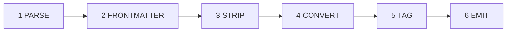
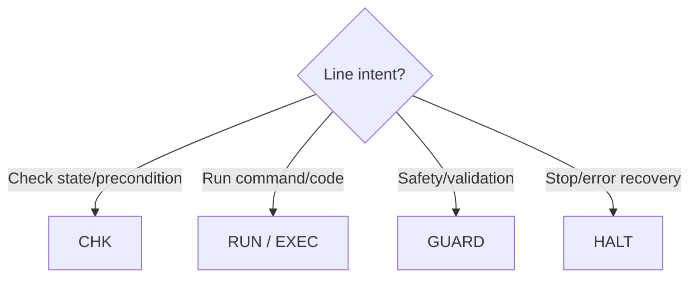

# SKILL:OPTIMIZE_LLM_SKILL

> Purpose: compress a verbose Markdown skill into terse, token-optimized form with zero logic loss.

[CONTEXT: Context window constraints require stripping grammar filler, structural bloat, and padding while preserving 100% logic.]

## EXEC_FLOW

*What it does: the ordered pipeline applied to every input skill.*

1. PARSE: Read input Markdown. Isolate core objectives, variables, sequencing, and constraints.

2. FRONTMATTER: Enforce the target skill's frontmatter to this template (keep the target's own `name` and `description`; never replace them with this skill's values):

   ---
   name: <target name>
   description: <target description>
   license: MIT
   compatibility: opencode
   metadata:
     audience: <target audience>
     workflow: <target workflow>
     opencode/slash: true
     opencode/autoinvoke: false
   ---

   - GUARD: Move any non-template top-level fields (e.g., `version`, `triggers`, `requirements`, `cache`) under `metadata`.
   - GUARD: Set `opencode/autoinvoke` to `false` unless the user explicitly requests otherwise.
   - GUARD: Do not alter the target body except where steps 3-5 apply.

3. STRIP: Remove conversational fluff ("please note", "remember to", "next step is", "in order to").

4. CONVERT: Translate lengthy prose paragraphs into dense, bulleted or numbered constraints.

5. TAG: Prefix structural steps and rules with capitalized functional anchor tokens (e.g., `CHK:`, `RUN:`, `GUARD:`).

6. EMIT: Output the minimized format directly below the standard YAML frontmatter block.

## TRANSFORMATION_RULES

*What it does: the style rules that govern the rewritten text.*

• NO_PROSE: Replace narrative explanations with absolute declarative commands.

• TOKEN_FLATTEN: Remove heavy Markdown tables or deep nested lists. Use flat lists with minimal structural syntax (e.g., `•`).

• ANCHOR_TAGS: Apply specific programmatic prefixes to clarify instruction intent:

  - `CHK:` Testing environment states or evaluating preconditions.

  - `RUN:` / `EXEC:` Running terminal commands or code execution blocks.

  - `GUARD:` Strict safety checks or environmental validations.

  - `HALT:` Explicit termination states or error recovery triggers.

• BREVITY_FIRST: Reduce token footprint by 50-70% while keeping variable names and raw shell/API commands completely intact.

## EXAMPLES

*What it does: one before/after pair showing the transformation.*

### [INPUT_PROSE]

"Before you do anything else, you should really make sure that you pull down the latest changes from the git repository. You can do this by opening up your terminal and running git pull origin main. This ensures you don't run into annoying merge conflicts later down the line when you try to push."

### [OUTPUT_TERSE]

"• CHK: Ensure local branch is sync'd. RUN: `git pull origin main` (Prevents merge conflicts)."
