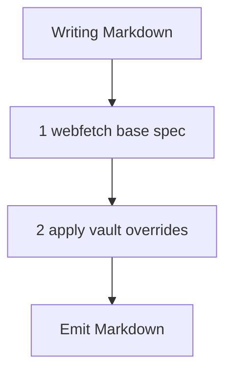

# Obsidian Flavored Markdown Skill

> Purpose: apply Obsidian Flavored Markdown rules, plus vault-specific overrides, to all Markdown the agent writes.

TRIGGER: Use whenever the agent writes Markdown to a vault or file.

## 1. Base Specification

*What it does: loads the canonical Obsidian Markdown rules as the baseline.*

- RUN: `webfetch` `https://raw.githubusercontent.com/kepano/obsidian-skills/main/skills/obsidian-markdown/SKILL.md` on skill activation.
- GUARD: Follow it as the baseline standard.

## 2. Vault Overrides

*What it does: vault rules that take precedence over the baseline.*

- GUARD: Internal links use `[[Note Name]]` wikilinks.
- GUARD: Markdown-style `[text](url)` links for external links only.
