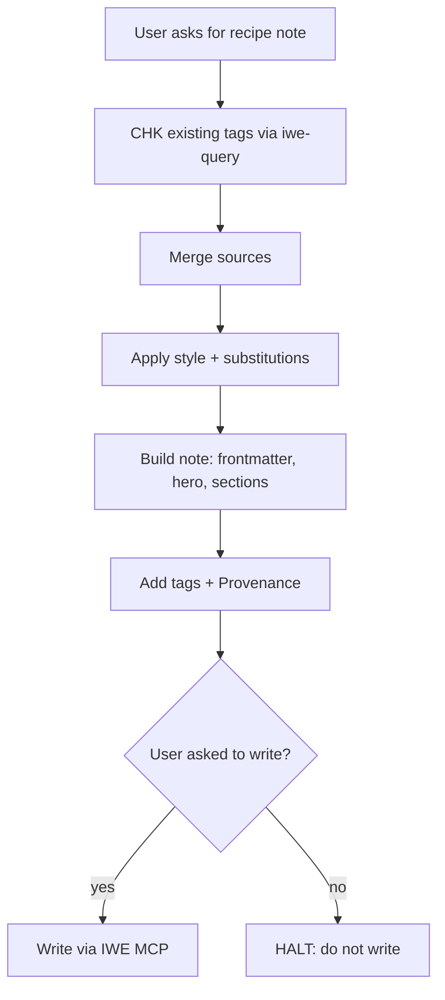
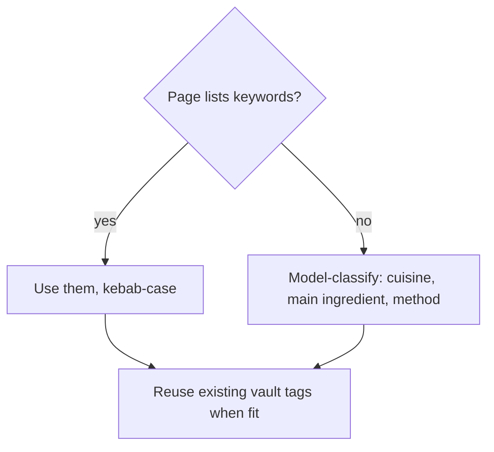

# Recipe Ingest Skill

> Purpose: turn a recipe source into a terse, consistently structured vault note.

## Flow

*What it does: shows the order of steps from request to note.*



## Note Location

*What it does: where the file goes.*

1. EXEC: Create in `pages/`, named `<Recipe Name>.md`.

## Frontmatter

*What it does: required metadata block.*

``` yaml
---
tags:
  - recipe
cook_time: <N minutes>
prep_time: <N minutes>
serves: <N or range>
source: <URL>
---
```

## Sections

*What it does: exact body order.*

Order, exact form:

1. Hero image: `![[<image file>]]` directly under frontmatter. GUARD: no title line.
2. `# Summary`: 1–2 sentences. Method + why it differs from default.
3. `# Ingredients`: `- ` bullets, quantity first. Keep any ranges. Source conflicts in `==...==`.
4. `# Directions`: numbered steps. Imperative, one action per step.

## Style

*What it does: wording rules.*

- Short, terse prose. Strip commentary that doesn't help cook the dish.
- Keep source wording only when it matters (e.g., "optional").
- Fix typos. Normalize units (tsp, Tbsp, lb).

## Merging Sources

*What it does: resolves multi-source differences.*

- Compatible ranges: keep range (e.g., `2–3 Tbsp`).
- Quantity contradictions: write both values, highlight as conflict.
- Item in one source only: keep; note source if it matters.

## Substitutions

*What it does: spice conversions and blend placement.*

- Whole to ground spice: 1 tsp ground ≈ 1 whole stick (~2 in) cinnamon, or ≈ 1 tsp whole cumin or coriander seed (use less coriander).
- GUARD: put a blend in a `## Garam Masala` subsection under Ingredients, not a loose line.

## Headings

*What it does: heading levels.*

- GUARD: sections are `#`, not `##`. No title heading (filename is title).

## Provenance

*What it does: records why/when the agent made the note.*

- Agent-created notes: `## Provenance` at bottom: `"<quote>" — [[YYYY-MM-DD]]` plus reason for the note.

## Vault Access

*What it does: how and when to touch the vault.*

- RUN: use IWE MCP tools for reads and writes (`iwe-query` skill).
- GUARD: write only when the user asks.

## Tags

*What it does: tag selection order.*



1. Add `#recipe` plus 2–3 tags from the recipe.
2. Source keywords first: use the webpage's listed keywords/tags when present, converted to kebab-case.
3. If page lists none: classify with a model, add 2–3 tags (cuisine, main ingredient, method; e.g., `#bengali`, `#chicken`, `#pressurecooker`).
4. CHK: reuse existing vault tags when they fit. RUN: check with `iwe-query` first.
