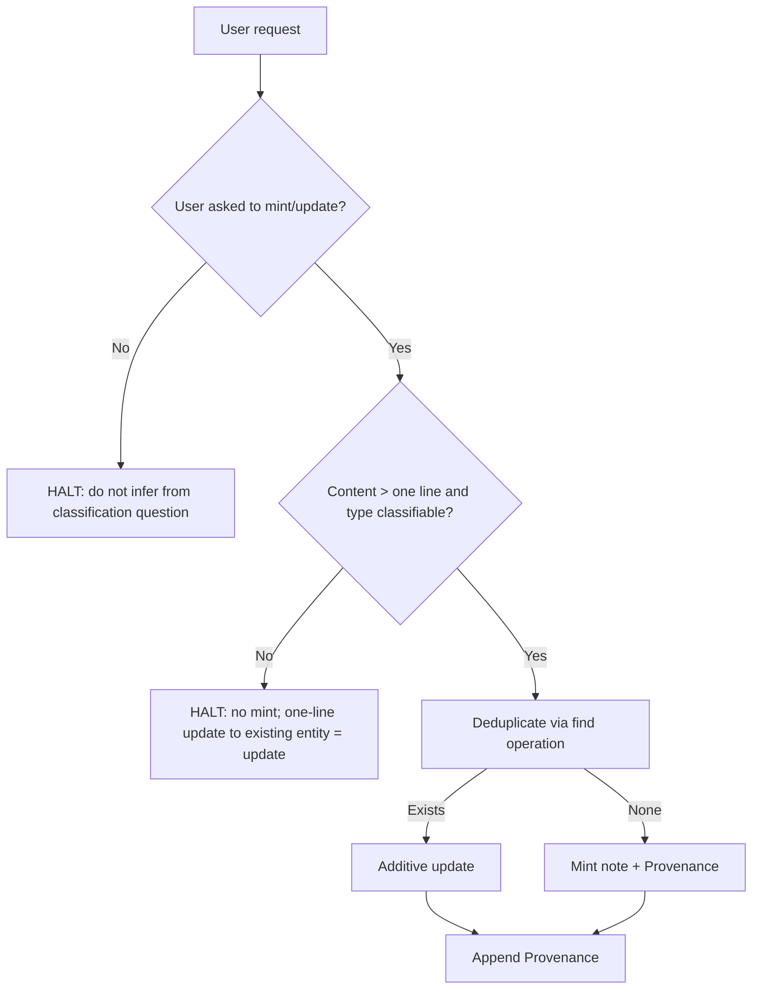
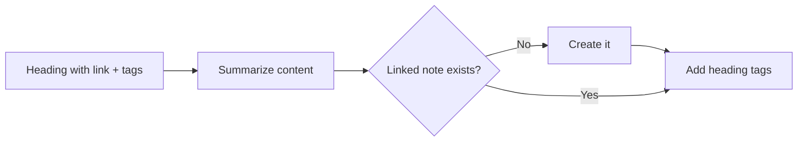

# Knowledge Wiki Management Skill

> Purpose: create, classify, and maintain notes in the Karpathy-style LLM Knowledge Wiki.

## Access

*What it does: selects the backend for note operations.*

- EXEC: ACCESS: Read the prompt's access rule. If it says iwe is available, use the iwe backend. Otherwise use the filesystem backend.
- Steps in this skill refer to abstract operations; resolve them via the table below.

| Operation | iwe | Filesystem |
|---|---|---|
| read note | iwe_retrieve | read .md file |
| write / create | iwe_create / iwe_update | write .md file |
| find / query | iwe_find / iwe_query | grep the vault |
| rename | iwe_rename | move file |
| delete | iwe_delete | delete file |
| stats | iwe_stats | noop |
| link updates | automatic in iwe | noop |

## Main Flow

*What it does: overview of the mint/update path.*



## Writing Rules

*What it does: where and when agents may write.*

- GUARD: Write anywhere in vault only when user asks, except `wiki/memory/` (see Memory).
- GUARD: Journal and page notes are human-authored. Write only when asked.
- GUARD: Never overwrite/remove human-authored content unless user explicitly asks.

## Dates

*What it does: date format standard.*

- Use ISO 8601 (`YYYY-MM-DD`) in notes, filenames, frontmatter, task metadata.
- Task dates use Dataview inline fields: `[due:: YYYY-MM-DD]`, `[scheduled:: YYYY-MM-DD]`, `[completed:: YYYY-MM-DD]`.

## Journal Logging

*What it does: rules for writing to the daily journal.*

Trigger: user says "record this in the journal for [note]" or "write this down".

- EXEC: Write to today's daily note, `journal/YYYY-MM-DD`.
- EXEC: Upsert top-level heading `# [[Exact Note Name]]` for the source note. Exists → append under it. Else → add at end.
- Record discoveries and decisions as dated summaries (bullets or subheadings as fits).
- GUARD: Write only when user asks.
- CHK: User names source note exactly. No name → ask.
- User says "I don't know," "doesn't matter," or "just today" → use `# Today`.
- "The note we're working on" = note from current conversation. Unclear → ask.

## Assets

*What it does: where assets are stored.*

- Store asset next to the note that imported/created it.
- Asset imported solely for a new entity → store next to that entity.
- GUARD: Never copy assets. Link to them.

## Memory

*What it does: agent-owned notes for future turns/sessions.*

`wiki/memory/` = notes the agent writes for itself for future turns or sessions.

- **Tasks**: Agent-written tasks for the agent in a future turn. Not for humans. Format as markdown tasks (`- [ ]`) for human review; add `[due:: YYYY-MM-DD]` when relevant. One line each: no heading method, no provenance.
- **Memories**: Lessons, durable fixes, rules, in markdown. Agents record autonomously (e.g. after a tool error with a durable fix, or when user says "When I say X, do Y"). Include a `## Provenance` section.
- The rule against copying tasks into `wiki/graph/` does not apply to `wiki/memory/`.

## Naming

*What it does: slug convention for graph nodes.*

- Graph nodes use the full official name as slug (e.g. `victron-energy`). Keep shorthand names in `aliases:`.

## Entity Typing with Tags

*What it does: how to type entities via tags.*

- Entity types = Obsidian tags named like schema.org types (e.g. `#person`, `#organization`, `#book`). No fixed list.
- CHK: Before creating a type tag, search vault for existing tags using the find / query operation. Reuse a fitting tag even if wording differs (e.g. `#organization` not `#company`). Create new only when none fits.
- GUARD: No overly general types (`#concept`, `#thing`, `#entity`) unless the user created them.
- `#idea` = evolving research topic. Add `#project` when it produces work product.
- Unknown last name → first name + context as stand-in, e.g. `Lisa - Martin Lane Neighbor`.

Two ways to type an entity:

- **Whole note is about the entity**: Add type tag in frontmatter. Note title = entity name.

  ``` yaml
  tags:
    - person
  ```

- **Only heading children are about the entity**: Tag the heading. Heading text = entity name, tag = type.

  ``` markdown
  # Bob Dole #person
  ```

## Entity Properties

*What it does: property conventions.*

- Properties are frontmatter or inline `[name:: value]`.
- Names and types are free-form; no schema restricts them.
- Values may be wikilinks.

## Workflow for Minting & Updating Entities

*What it does: gates and steps for creating/updating entity notes.*

GUARD: Mint/update only when user asks. Don't infer a mint request from a classification question.

- HALT: Blank or one-line content → don't mint. A one-line update to an existing entity → update it.
- HALT: Type can't be classified with confidence → don't mint.
- Heading-based ingestion requires a link to the entity: `# [[Name]] #type`.
- Link target missing → mint note with name matching the link, or update the source link. Human source notes need user approval before any link change.
- CHK: Clicking an unresolved link in Obsidian creates an empty note. After minting, check for it; delete if it duplicates the new note.

1. **Deduplicate**: CHK: Before minting, use the find operation to look for an existing note for the same entity. Exists → update, don't duplicate.
2. **Minting**: EXEC: Start new note with short summary/description of the entity. No mandatory sections except `## Provenance`.
3. **Additive Updates**:
   - GUARD: Never overwrite/remove human-authored content unless user explicitly asks.
   - GUARD: Never copy tasks (`- [ ]` / `- [x]`) into graph nodes. Tasks stay in source notes and surface via backlinks.
   - GUARD: Never copy source content. Link to it; short quotes or summaries OK.

## Provenance

*What it does: audit trail rules for agent-made changes.*

- **Minting**: Agent-created note → record triggering notes under `## Provenance`.
- **Editing**: Agent edits a note it created → append to `## Provenance` the reason and the causing notes.
- **Citation Format**: Internal wiki link to source note + quote of triggering text.
  - `"Quote from source text" — [[YYYY-MM-DD]]`
- **Human-Authored Notes**: Asked to change a note the agent did not create → add `## Provenance` at bottom, same citation format.

## Archiving

*What it does: retiring nodes.*

GUARD: Archive only when user asks.

- Retired/historical nodes get `archived: YYYY-MM-DD` in frontmatter and move to `wiki/archived/` via the rename operation.
- Agents treat archived nodes as inactive when answering about current focus or active projects.

## Heading-Based Ingestion

*What it does: turning human heading sections into entity-note content.*

GUARD: Only when user asks. Human pages often link a note in a heading; content beneath is about the linked note:

``` markdown
# [[A New Project]] #project

Spontaneous thoughts, specifications, context, or decisions...
- [ ] Task to execute [due:: 2026-10-15]
- [x] Completed task [completed:: 2026-10-10]
```



1. EXEC: Summarize content into linked note, following workflow and provenance rules.
2. CHK: Linked note missing → create it.
3. EXEC: Add heading's tags to linked note. Tags often define the type, as `#project` above.
